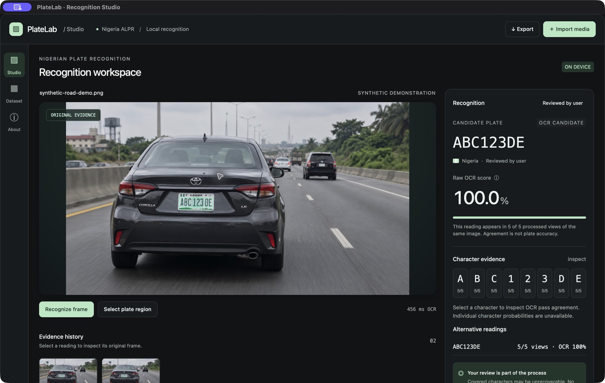

# PlateLab: Nigerian licence-plate recognition under partial occlusion

Local licence-plate recognition prototypes for **macOS and Android**, by **Akinwale Awoyele**. Both apps read visible plate text, show recognizer evidence, and support human review. They have separate native implementations and build processes.

Current releases: **macOS 0.5.0**, build **7**, and **Android 0.6.0**, version code **7**. Release metadata lives in `apps/macos/ui/release.js`; the interface and build script use the same version. See `CHANGELOG.md` for changes. New compatible features increment the minor version, fixes increment the patch version, and breaking changes increment the major version.

The custom application icon is stored in `shared/branding/platelab-icon.png`. The build script creates the standard and Retina `.icns` sizes and registers the icon in the macOS bundle.

## Project layout

```text
apps/
  macos/          Swift app, browser interface, build scripts, and tests
  android/        Android Studio/Gradle app, resources, and Android tests
shared/
  branding/       Original PlateLab icon and its design notes
backend/
  firebase/       Proposed database rules and local emulator checks
research/         Manuscript, research guides, dataset tools, and requirements
scripts/          Commands that build both apps
docs/             Shared documentation and the approved synthetic screenshot
```

Each app is self-contained. macOS uses Apple Vision and Android uses bundled ML Kit; they share branding but do not import each other's app code. Local packages are grouped under `dist/macos/` and `dist/android/`. Development caches are kept in the ignored `build/` directory.

| Platform | Source and setup | Local package |
| --- | --- | --- |
| macOS | [macOS app](apps/macos/README.md) | `dist/macos/PlateLab.app` |
| Android | [Android app](apps/android/README.md) | `dist/android/PlateLab-Android-0.6.0.apk` |

## App screenshot



This screenshot is from the initial macOS prototype and uses the invented plate `ABC 123 DE`. It shows the interface, not measured recognition accuracy.

## Current macOS implementation

- Native macOS `.app`, built with Swift, WKWebView and Apple's on-device Vision OCR.
- Image and video import, user-selected plate region, text bounding boxes and alternative candidates.
- Live RTSP/IP-camera connection with continuous recognition, pause/resume, and disconnect.
- Sequential video processing at one sampled frame per second; stop control and a 120-frame run limit.
- Raw OCR confidence, manual transcription, review status and JSON export.
- Light/dark appearance control with a saved preference; a wrapping header and visible navigation on compact windows.
- A Bitcoin donation panel with wallet support, QR code, and copy-address action.
- Frames capped at 1280 pixels on their longest side; at most 12 previews and 1,000 text records retained.
- Python tools for dataset inventory, duplicate audit, baseline timing and a labelled synthetic video.

The app has **not** been trained on this dataset. It does not yet implement a CRNN–CTC model, occlusion reconstruction, vehicle tracking, temporal fusion, or calibrated per-character confidence. The recognizer score is not the probability that a complete plate is correct; even a score of 100% can accompany a wrong reading. All readings require review. Standard format matching is a heuristic and can exclude valid nonstandard plates.

## Run on macOS

Requires macOS 13 or newer and Apple command-line developer tools to build:

```sh
python3 apps/macos/scripts/build.py
open dist/macos/PlateLab.app
```

The resulting app runs without Python, a web server, cloud inference, or downloaded neural weights. It is locally ad-hoc signed, not notarized for public distribution. The current build targets the host architecture; the tested build is Apple Silicon. A Windows executable is **not implemented**; it needs a different OCR backend and packaging.

Open `dist/macos/PlateLab.app` from Finder as a macOS application. If an earlier version is running, export any results you want to keep, quit it, and reopen the updated app. Rebuilding does not replace an already-running process. Recognition history is currently held in memory. If the system's selected SDK does not match its Swift compiler, set `SDKROOT` to a compatible installed SDK before building; this machine was verified with `/Library/Developer/CommandLineTools/SDKs/MacOSX15.4.sdk`.

## Live street-camera feeds

Build with the optional camera decoder:

```sh
python3 -m venv .venv
.venv/bin/python -m pip install -r apps/macos/requirements-live.txt
.venv/bin/python apps/macos/scripts/build.py
open dist/macos/PlateLab.app
```

Select **Live feed**, enter your camera's RTSP URL and a camera name, then select **Connect**. The app supports RTSP over TCP and HTTP/HTTPS video streams. It recognizes the newest sampled frame up to once per second; slower OCR reduces that rate without accumulating a backlog. Pause recognition to inspect a reading, select a fixed plate region, or edit/review results. Resume continues with the newest frame. Disconnect closes the camera connection.

Exports include the camera name, time since connection, and frame capture time. Camera URLs and credentials are not saved in reports. At most 12 image previews and the newest 1,000 records are retained. Recognition remains the Apple Vision baseline; live mode does not add vehicle tracking, temporal fusion, or calibrated recognition accuracy.

FFmpeg is a separate decoder executable bundled at build time. Python is not required to run the resulting app. Its license and build information are included in `Contents/Resources/FFmpeg-LICENSE.txt`; FFmpeg's own distribution terms apply to that executable. Builds without the optional dependency retain image/file-video recognition. Use `--without-samples` to omit local dataset samples, or `--output PATH` for a separate build.

For an optional browser development preview after building:

```sh
python3 apps/macos/scripts/dev_server.py
# Visit http://127.0.0.1:58070
```

## Distant plates and detailed capture

On Android, enable **Distant plates** before importing a photo or starting the camera. In camera mode, use the supported zoom slider and tap the plate to focus, then choose **Capture detailed photo**. Capture pauses the camera and opens the still image; drag a tight plate area and choose **Recognize photo**. Imported images in this mode retain up to 4096 pixels on the long edge. The device chooses the supported still-capture resolution; digital zoom may enlarge blur rather than add useful detail.

On macOS, enable **Distant plates**, import media, and select the plate region. Native OCR crops from the original file decoded at up to 4096 pixels instead of relying on the 1280-pixel preview. High-detail RTSP connections use up to 2560 pixels without enlarging a smaller feed; pause and select the plate before recognizing. Live OCR uses the exact frame shown to the user. Camera optical zoom and a high-resolution stream help preserve real detail; the app cannot recover characters that the sensor did not capture. No distance in meters or accuracy improvement has been validated. See [detailed capture notes](docs/distant-plates.md).

The refreshed interface uses glass-inspired gradients, translucent macOS surfaces, soft borders and highlights, and rounded controls in both themes. The macOS appearance respects reduced-motion and reduced-transparency preferences.

## Local weather

Select **Weather** in the macOS navigation or **Local weather** near the Android appearance button. Choose **Use my location** and grant location permission, or type a street, address or city and select a suggestion. Suggestions appear after a short pause; add your city to distinguish similarly named streets. The section shows current modeled conditions, temperature and feels-like temperature in °C, wind in km/h, humidity, and a three-day forecast with daily highs/lows and rain probability. Refresh fetches a new forecast for the selected area; the provider's local forecast time and timezone are shown.

Weather is optional and requires internet. Coordinates are rounded to two decimal places before forecast requests; address searches go to Photon/OpenStreetMap, and forecast requests go to Open-Meteo; both providers receive the request IP address. Suggestions can use the previously selected approximate area to rank nearby matches. This feature does not add location or weather to recognition reports or save a weather location to disk. Android requests approximate foreground location only; there is no background-location permission. Closing weather or leaving the Android app cancels pending work. Denied/unavailable location, offline access, missing data, and service failures offer retry or city search; old forecasts are identified as previous data. OCR continues to work offline.

Weather data: [Open-Meteo](https://open-meteo.com/), [CC BY 4.0](https://open-meteo.com/en/licence); address suggestions: [Photon](https://github.com/komoot/photon) / [© OpenStreetMap contributors](https://www.openstreetmap.org/copyright). The public Photon service has no availability guarantee; searches are delayed, canceled when replaced, and cached briefly in memory to limit requests. This prototype uses the free **noncommercial** API without an API key. Commercial deployment or larger usage requires reviewing the provider's [terms and limits](https://open-meteo.com/en/terms); no paid service has been registered.

## Support PlateLab

Select **Support us** to donate BTC to `3DhdtBbkE7TsiZzAU5JJuV3M7dYzygj8R2`. Scan the QR code with a Bitcoin wallet, or copy the address. In the native macOS app, **Open Bitcoin wallet** opens an installed handler for the Bitcoin payment URI; if none is available, the panel shows the QR/copy alternatives. The browser preview stays on the panel instead of sending Safari to an unsupported address.

This is a direct wallet donation, with no hosted payment gateway or card checkout. The donor chooses and confirms the amount in their wallet. The app does not process funds or verify payment completion.

## Dataset stays local

**Do not commit or upload the dataset, crops, screenshots, predictions, or derived videos to GitHub.** `data/`, `outputs/`, `build/`, `dist/` and media files are ignored. The local build may include a small selection of local samples for demonstration. Those samples are not part of the source repository.

The author has authorized project use of his dataset. No public redistribution licence has been specified. See `research/dataset_card.md` for the partial audit and limitations.

```sh
python3 -m venv .venv
.venv/bin/python -m pip install -r research/requirements-audit.txt
mkdir -p outputs/audit
.venv/bin/gdown 'YOUR_PUBLIC_DRIVE_FOLDER_URL' --json --no-cookies --timeout 30 > outputs/audit/drive_inventory.json
.venv/bin/python research/scripts/download_dataset.py
.venv/bin/python research/scripts/audit_dataset.py
.venv/bin/python research/scripts/benchmark_baseline.py
```

Download names use unique Drive IDs to prevent collisions on case-insensitive filesystems. Repeated failures stop further batches; rerun later to resume existing downloads. Do not interpret a partial download as the complete dataset.

To create the explicitly labelled **synthetic** road-motion demonstration:

```sh
.venv/bin/python -m pip install -r research/requirements-demo.txt
.venv/bin/python research/scripts/make_demo_video.py
```

This transforms a source photograph into a moving inset over a road illustration with an artificial occluder. It is not recorded highway footage and must not be used to claim highway accuracy.

## Validation

```sh
node --test apps/macos/tests/*.test.js
python3 -m compileall -q apps/macos/scripts apps/android/scripts research/scripts
```

Release 0.2.0 was checked with JavaScript workflow regressions and an end-to-end synthetic RTSP feed that exercised the native decoder, successive frames, Apple Vision recognition, and disconnect. A real street-camera feed has not yet been supplied or tested.

On the 154 downloaded 699×466 images, a local benchmark on 2026-10-13 completed without OCR process failures: median 142.9 ms, p95 155.8 ms, peak child-process RSS 54.84 MiB. Each invocation launched a fresh OCR process. These are descriptive timings, **not recognition accuracy**. The memory figure excludes the desktop UI and WebKit processes. No ground-truth test set exists yet. See `research/validation.md`.

## Research direction

The [IEEE-style article draft](research/manuscript/README.md), **Nigerian License Plate Recognition Under Partial Occlusion: A Local Prototype and Mathematical Framework**, by Akinwale Awoyele, is available as [PDF](research/manuscript/platelab_partial_occlusion.pdf) and [editable LaTeX](research/manuscript/platelab_partial_occlusion.tex). It includes numbered mathematical models and clearly distinguishes implemented behavior, historical timing measurements, and proposed research. It has not been submitted or accepted; recognition accuracy and improvements under occlusion remain unmeasured.

The planned research baseline is CRNN–CTC. Future experiments must use verified transcripts, plate regions, vehicle-identity-disjoint splits, occlusion severity labels, uncertainty calibration and an untouched test set. Any new method must be compared against credible baselines with ablations. Current app functionality establishes an inference and review workflow; it does not establish scientific novelty or solve missing visual information.

See `research/submission_guide.md` for today's demonstration and `research/experiment_protocol.md` for the remaining research work.

## Android prototype

The native Android implementation is in `apps/android/`. It uses bundled ML Kit for photo and live phone-camera recognition, with review, private text history, and JSON export. Android is independently versioned; the current version is 0.6.0, with saved light/dark appearance, a first-launch guided tour, and optional Google sign-in. Accounts do not upload or sync readings in this release. See [Firebase setup](docs/firebase.md) for configuration, privacy boundaries, and tested database rules. See `apps/android/README.md` for building, installation, testing, and the features not yet ported from macOS.

© 2026 Akinwale. The source code is available under the [MIT License](LICENSE).
